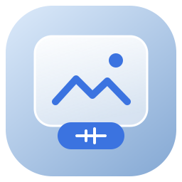
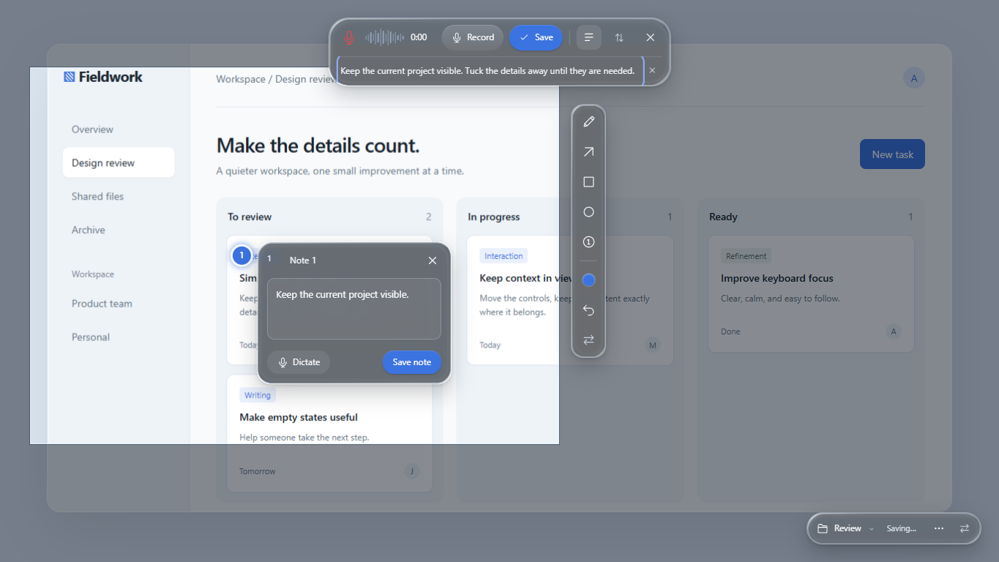
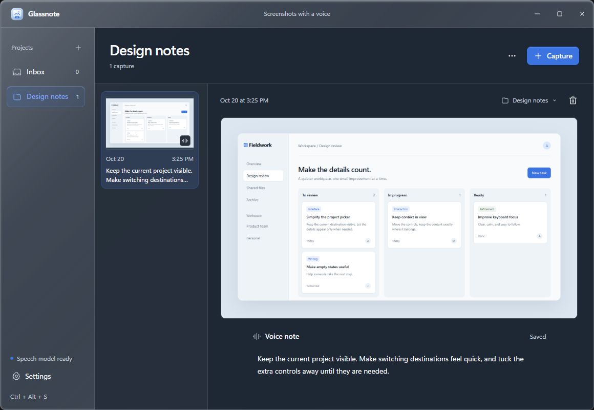
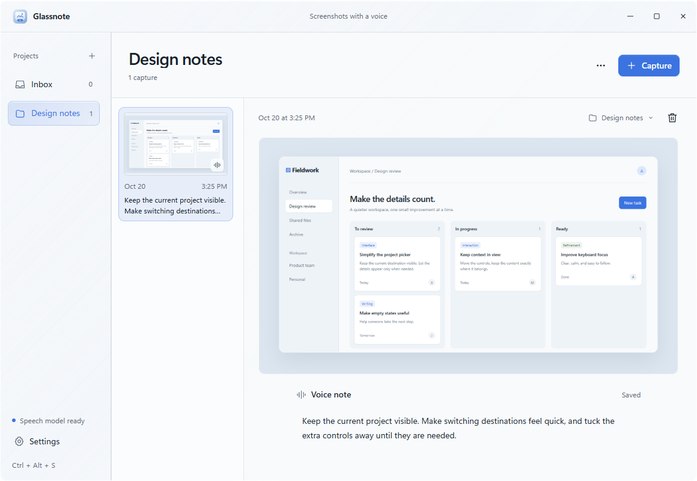

<p align="center"></p>

# Glassnote

**Capture what you see. Keep what you mean.**

A small Windows screenshot app with offline voice transcription, numbered notes,
and a quiet liquid-glass overlay. Capture a region, explain it, save it to a
project, and get back to work. Share the actual images and linked context with
people or AI coding agents as ordinary files.

[**Download for Windows 11**](https://github.com/YG99999/glassnote/releases/latest)
 · [Quick start](#quick-start) · [Build from source](docs/build.md)
 · [Report a bug](https://github.com/YG99999/glassnote/issues/new/choose)

[](https://github.com/YG99999/glassnote/actions/workflows/windows.yml)
[](https://github.com/YG99999/glassnote/releases/latest)
[](LICENSE)



*The real interface with synthetic demo content. The desktop stays frozen while you annotate and dictate.*

## What it does

- **Click for a full-screen screenshot, drag for a region.** Start with
  `Ctrl+Alt+S`, the desktop shortcut, or the tray menu.
- **Speak locally.** Live English dictation uses Whisper tiny.en on your CPU.
  Stop to refine, edit the text, or continue recording to append another thought.
- **Point to the detail.** Draw, add arrows and shapes, or place numbered notes.
  Write or dictate directly beside a pin; save it to tuck the editor away.
- **Capture, save, carry on.** Compact controls avoid the selected region and can
  switch edges. Saving confirms the destination without opening the library.
- **Organize lightly.** Named projects have one level of collapsible subfolders,
  automatically numbered from `0`. Switch or create destinations from the overlay.
- **Share useful context.** Copy a prepared folder path or export a ZIP containing
  real PNGs, concise Markdown notes, stable IDs, and optional audio and geometry.

Built with **Rust + Tauri 2**, a small TypeScript interface, and WebView2.
No Electron runtime, cloud transcription, account, subscription, or telemetry.
The ~32 MB English model downloads once; captures and speech stay on your PC.

## Quick start

1. Download and run the **x64 Windows installer** from
   [Releases](https://github.com/YG99999/glassnote/releases/latest).
   This early release is unsigned, so Windows may show a publisher warning.
2. Open Glassnote. Download the English model in **Settings** for voice notes.
   Screenshots and typed notes work without it.
3. Press **Ctrl+Alt+S**. Click for the whole monitor or drag to select a region.
4. Record or annotate, choose a project, then **Save**. Open the library later.

Closing the library keeps Glassnote in the tray. Use **Exit** there to quit.
The desktop capture shortcut can start the app; the global hotkey needs it running.
Nothing starts automatically with Windows.



<details>
<summary>Light theme</summary>



</details>

## Files an agent can actually read

Copy a folder path into your coding agent, or attach the ZIP. Start with the
export's `README.md`, open only the relevant `capture.md`, then inspect its actual
`screenshot.png` with an image tool. The image contains numbered markers; the
matching text and pixel coordinates live alongside it.

```text
Design review/
  README.md                 # compact index, links to captures and subfolders
  project.json              # stable IDs, timestamps, relative file links
  001/
    screenshot.png          # image with drawings and numbered markers
    capture.md              # transcript + numbered notes, once
    transcript.txt
    audio.wav               # only when recorded
    original.png            # only when annotated
    notes.txt               # when annotated; may be empty
    objects.json            # drawing bounds, when shapes exist
    annotations.json        # only when annotated; full editable geometry
  folders/
    0/                      # optional numbered subfolder, same layout
```

The index avoids loading all capture text into context. Audio and full stroke
geometry are optional reads. Export just a subfolder when that is all you need.
[File format and privacy details](docs/usage.md#files-and-privacy).

## Status and limits

**v0.1.0 is an early Windows 11 x64 release.** English only; accuracy depends on
speech, accent, background noise, and hardware. Tiny Whisper favors quick local
feedback over maximum accuracy. No cloud API key or GPU is required. Local speech requires an AVX2-compatible
x64 CPU with FMA, F16C, and BMI2; unsupported CPUs can still use screenshots and
typed notes.

The capture material adapts the MIT-licensed
[egui-glass shader](https://github.com/heonny/egui-glass) to WebGL2; the library
uses Windows acrylic where available. Opaque and reduced-motion fallbacks are
available. This is not Apple's native Liquid Glass.

Automated Rust and browser checks cover the shipped paths. Mixed-DPI multi-monitor
hardware and microphone disconnection still need hands-on testing.
[Verification and measured speech timing](VERIFICATION.md).

## Develop and contribute

See [build instructions](docs/build.md), [contributing](CONTRIBUTING.md), and the
[changelog](CHANGELOG.md). Reproducible bug reports, accessibility improvements,
and real Windows hardware feedback are welcome. Please check existing issues
before opening a feature request.

Glassnote is [MIT licensed](LICENSE). Third-party components and the speech model
retain their own licenses; see [notices](THIRD_PARTY_NOTICES.md).
